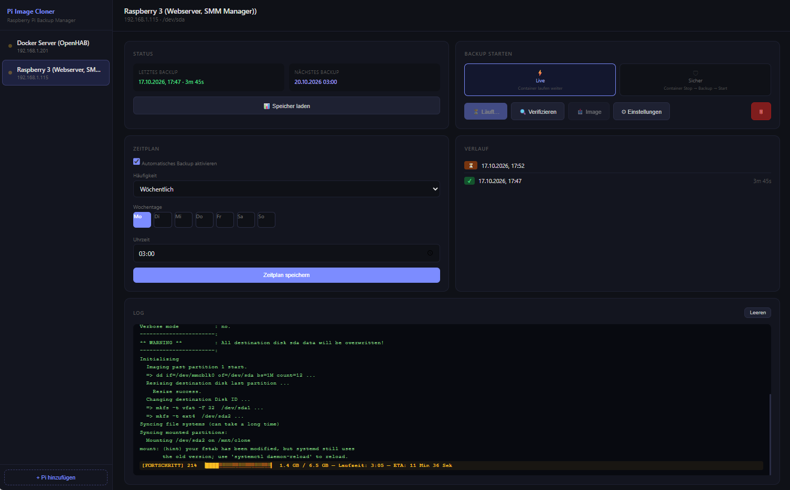

# 🫐 rpi-image-cloner

A web-based tool to clone and backup Raspberry Pi SD cards via SSH — with automated weekly schedules, boot-partition auto-fix, and a clean browser UI.

**DE:** Web-Tool zum Klonen und Backup von Raspberry Pi SD-Karten via SSH — mit automatischen Wochenplänen, Boot-Partition Auto-Fix und einer übersichtlichen Browser-Oberfläche.



---

## How it works

1. The tool connects to your Raspberry Pi via SSH
2. Starts `rpi-clone` on the Pi (clones the running SD card to a backup card)
3. Automatically repairs `cmdline.txt` and `fstab` on the backup card (correct PARTUUID)
4. The backup card is directly bootable — no manual intervention needed

> **Portainer users:** The `docker-compose.yml` can be pasted directly as a stack in Portainer. The volume `rpi_cloner_data` stores the database persistently.

---

## ✨ Features

- **Automated backups** — weekly schedules via cron, runs while you sleep
- **Boot auto-fix** — automatically repairs `cmdline.txt` and `fstab` after clone (correct PARTUUID)
- **Progress monitoring** — live progress display with elapsed time and data copied
- **Backup verification** — checks filesystem integrity after backup
- **SSH keepalive** — stable connections even for backups taking 2+ hours
- **Encrypted credentials** — SSH passwords stored with Fernet encryption
- **Multiple servers** — manage several Raspberry Pis from one interface

---

## 🧰 Stack

| Component | Technology |
|-----------|-----------|
| Backend | Python · FastAPI · Uvicorn |
| SSH | Paramiko |
| Scheduler | APScheduler |
| Clone engine | [rpi-clone](https://github.com/billw2/rpi-clone) (must be installed on target Pi) |
| Database | SQLite |
| Frontend | HTML · Jinja2 |
| Container | Docker |

---

## 🚀 Quick Start (Docker / Portainer)

### Option 1 — docker-compose

```yaml
version: '3.8'

services:
  rpi-image-cloner:
    image: rpi-image-cloner:latest
    container_name: rpi-image-cloner
    ports:
      - "8099:8000"
    volumes:
      - rpi_cloner_data:/app/data
    environment:
      - TZ=Europe/Zurich      # ← Change to your timezone
    restart: unless-stopped

volumes:
  rpi_cloner_data:
```

### Option 2 — Build from source

```bash
git clone https://github.com/pierrecinema/rpi-image-cloner.git
cd rpi-image-cloner
docker build -t rpi-image-cloner:latest .
docker compose up -d
```

Open **http://localhost:8099** in your browser.

---

## 📋 Step-by-step Setup Guide

### Step 1 — Enable SSH on your Raspberry Pi

If SSH is not already enabled:

```bash
sudo raspi-config
# → Interface Options → SSH → Enable
```

Or create an empty `ssh` file in the boot partition before first boot:

```bash
touch /boot/ssh
```

---

### Step 2 — Install rpi-clone on each Raspberry Pi

SSH into your Pi and run:

```bash
sudo wget https://raw.githubusercontent.com/billw2/rpi-clone/master/rpi-clone \
     -O /usr/local/sbin/rpi-clone
sudo chmod +x /usr/local/sbin/rpi-clone
```

Verify it works:

```bash
sudo rpi-clone --help
```

---

### Step 3 — Insert a backup SD card into the Pi

- Use a USB SD card adapter plugged into the Pi
- The backup card should be at least as large as the used space on your main card (does not need to be the same size)
- The card will appear as `/dev/sda` — verify with `lsblk`

```bash
lsblk
# You should see:
# mmcblk0   (your running SD card)
# sda       (your backup SD card via USB)
```

> ⚠️ All data on the backup card will be overwritten during the first backup.

---

### Step 4 — Deploy rpi-image-cloner with Docker

**Option A — docker-compose (recommended)**

Create a `docker-compose.yml`:

```yaml
version: '3.8'

services:
  rpi-image-cloner:
    image: rpi-image-cloner:latest
    container_name: rpi-image-cloner
    ports:
      - "8099:8000"
    volumes:
      - rpi_cloner_data:/app/data
    environment:
      - TZ=Europe/Zurich      # ← Change to your timezone
    restart: unless-stopped

volumes:
  rpi_cloner_data:
```

Build and start:

```bash
git clone https://github.com/pierrecinema/rpi-image-cloner.git
cd rpi-image-cloner
docker build -t rpi-image-cloner:latest .
docker compose up -d
```

**Option B — Portainer Stack**

1. Open Portainer → Stacks → Add Stack
2. Paste the `docker-compose.yml` above
3. Click **Deploy the stack**

---

### Step 5 — Open the web UI

Open **http://\<your-docker-host\>:8099** in your browser.

---

### Step 6 — Add your Raspberry Pi

1. Click **+ Pi hinzufügen** (Add Pi)
2. Enter a name, the Pi's IP address, SSH username and password
3. The device field defaults to `/dev/sda` — change only if your backup card appears elsewhere

---

### Step 7 — Run your first backup

1. Select your Pi from the sidebar
2. Click **Live** → **Backup starten**
3. Watch the live log and progress bar
4. When done, the backup card is fully bootable — no manual steps needed

---

### Step 8 — Set a weekly schedule (optional)

1. In the **Zeitplan** section, check **Automatisches Backup aktivieren**
2. Select the weekday and time
3. Click **Zeitplan speichern**

The backup will now run automatically every week at the chosen time.

---

## ⚙️ Troubleshooting

| Problem | Solution |
|---------|----------|
| Backup card not detected | Run `lsblk` on the Pi — if no `sda`, the USB adapter is not connected |
| SSH connection refused | Make sure SSH is enabled on the Pi (`sudo systemctl status ssh`) |
| rpi-clone not found | Repeat Step 2 — verify with `which rpi-clone` |
| `/mnt/clone` busy error | A previous backup is still running — wait or reboot the Pi |
| Backup card not booting | Run a new backup — the auto-fix will repair `cmdline.txt` and `fstab` |

---

## 🔐 Security

- SSH passwords are encrypted with [Fernet](https://cryptography.io/en/latest/fernet/) before storage
- The database (`cloner.db`) is stored in a Docker volume and never exposed
- No credentials are hardcoded in the source code

---

## 📁 Project Structure

```
rpi-image-cloner/
├── main.py          # FastAPI app, routes
├── ssh_backup.py    # SSH backup logic, POST-FIX boot repair
├── scheduler.py     # APScheduler weekly jobs
├── database.py      # SQLite helpers, credential encryption
├── requirements.txt
├── templates/
│   └── index.html   # Web UI
├── Dockerfile
└── docker-compose.yml
```

---

## 🇩🇪 Deutsch

**rpi-image-cloner** ist ein selbst gehostetes Web-Tool zum automatischen Backup von Raspberry Pi SD-Karten über SSH.

**Funktionsweise:**
1. Tool verbindet sich per SSH mit dem Raspberry Pi
2. Startet `rpi-clone` auf dem Pi (klont die laufende SD-Karte auf eine Backup-Karte)
3. Repariert automatisch `cmdline.txt` und `fstab` auf der Backup-Karte (korrekte PARTUUID)
4. Die Backup-Karte ist direkt bootfähig — kein manueller Eingriff nötig

**Für Portainer-Nutzer:** Das `docker-compose.yml` kann direkt als Stack in Portainer eingefügt werden. Volume `rpi_cloner_data` speichert die Datenbank persistent.

---

## 📄 License

MIT
